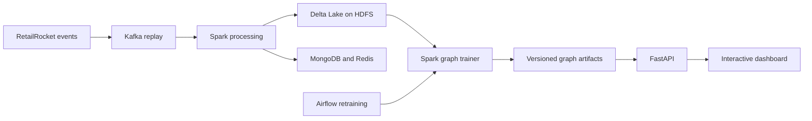

# RetailRocket Session Recommender

A graph-based recommender for e-commerce sessions. The project turns RetailRocket clickstream events into ranked product suggestions, serves them through FastAPI, and lets you inspect how recommendations change after simulated views, cart additions, and purchases.

[Run the demo](#run-the-demo) · [Evaluation](#evaluation) · [Vietnamese runbook](docs/GRAPH_RUNBOOK.md)

## Run the demo

On Windows, install Docker Desktop with Linux containers enabled. Download and extract the source bundle from the [Graph demo release](https://github.com/bluejames1106/big-data-retailrocket/releases/tag/graph-unified-v1), then run the following command from the extracted project directory in PowerShell.

```powershell
powershell -NoProfile -ExecutionPolicy Bypass -File scripts/run_graph_demo.ps1
```

Open the [interactive dashboard](http://localhost:8000/) or the [FastAPI documentation](http://localhost:8000/docs). The script builds the image, verifies the bundled pretrained snapshot, and starts the serving stack. The first build requires internet access. This demo exercises recommendation serving using the snapshot. The separate training and ingestion workflows are described in the [runbook](docs/GRAPH_RUNBOOK.md).

Stop the demo with `docker compose -f compose.graph-demo.yaml down`.

## Architecture



The trainer builds an **item co-occurrence graph** from visitor history and a **session transition graph** from consecutive interactions within a session. The serving policy blends their normalized scores at **75% item co-occurrence and 25% session transitions**. The scorer uses recent interactions, filters previously seen items, and falls back to popular items when it has insufficient graph context.

The offline evaluator and API use the same scorer. Model artifacts carry version and checksum metadata, and the dashboard displays the metrics associated with the active artifact.

## Evaluation

The full-data run processed **2,755,641 cleaned events**. All three methods were evaluated on the same **5,000 queries** after a time cutoff, using new items later in each session as labels. The table reports macro averages at rank 10 from the archived run.

| Method | Precision@10 | Recall@10 | NDCG@10 | Hit Rate@10 |
|---|---:|---:|---:|---:|
| **Session graph** | **4.13%** | **28.23%** | **19.67%** | **34.46%** |
| Spark ALS baseline | 0.15% | 0.84% | 0.49% | 1.36% |
| Popularity baseline | 0.07% | 0.43% | 0.20% | 0.74% |

The graph led on this offline benchmark. **4,213 of 5,000 queries** came from visitors absent before the cutoff, which favors a model that can use session context over the configured historical user-factor baseline. The ALS baseline used one untuned configuration, and the project has no online A/B result. The serving graph was refit on the complete cleaned history after the evaluation metrics were fixed.

See the [full results and caveats](docs/GRAPH_RESULTS.md) and [Windows/Docker verification report](docs/LOCAL_REVIEW_20261025.md).

## Train from source

Use Python 3.11 or 3.12 in a virtual environment and Java 17 for Spark. This example trains on the included 10,000-event sample, evaluates the ALS baseline, and activates the resulting graph artifact.

```bash
python -m pip install -r requirements-dev.txt
python -m pipeline.graph_training --input data/sample/events_10000.csv --run-id graph-sample-01 --compare-als --activate
python -m uvicorn service.app:app --host 127.0.0.1 --port 8000
```

With the API running, verify the artifact and serving behavior from another terminal.

```bash
python -m scripts.verify_graph --run-id graph-sample-01 --base-url http://127.0.0.1:8000
```

The sample run is a smoke check. To reproduce the full benchmark, obtain the original RetailRocket events, place them at `data/raw/events.csv`, and follow the [full-data instructions](docs/GRAPH_RUNBOOK.md#3-train-và-kích-hoạt-model-mới). The runbook also covers the Kafka-to-Spark integration demo and the Airflow retraining worker, which requires an integrated data run with its cleaned output available.

## Repository guide

| Location | Purpose |
|---|---|
| [`pipeline/graph_training.py`](pipeline/graph_training.py) | Spark training, temporal evaluation, and artifact export |
| [`pipeline/session_model.py`](pipeline/session_model.py) and [`pipeline/session_transition.py`](pipeline/session_transition.py) | Shared offline and serving recommendation logic |
| `service/` | FastAPI endpoints and dashboard |
| `orchestration/dags/` and [`pipeline/job_server.py`](pipeline/job_server.py) | Scheduled retraining and job execution |
| `demo/graph_snapshot/` | Compressed pretrained graph snapshot for the demo |
| [`docs/GRAPH_VALIDATION.md`](docs/GRAPH_VALIDATION.md) | Test coverage, evidence, and reproduction commands |

The project uses the RetailRocket e-commerce clickstream dataset. Source details, preprocessing, and checksums are recorded in the [evaluation report](docs/GRAPH_RESULTS.md).
