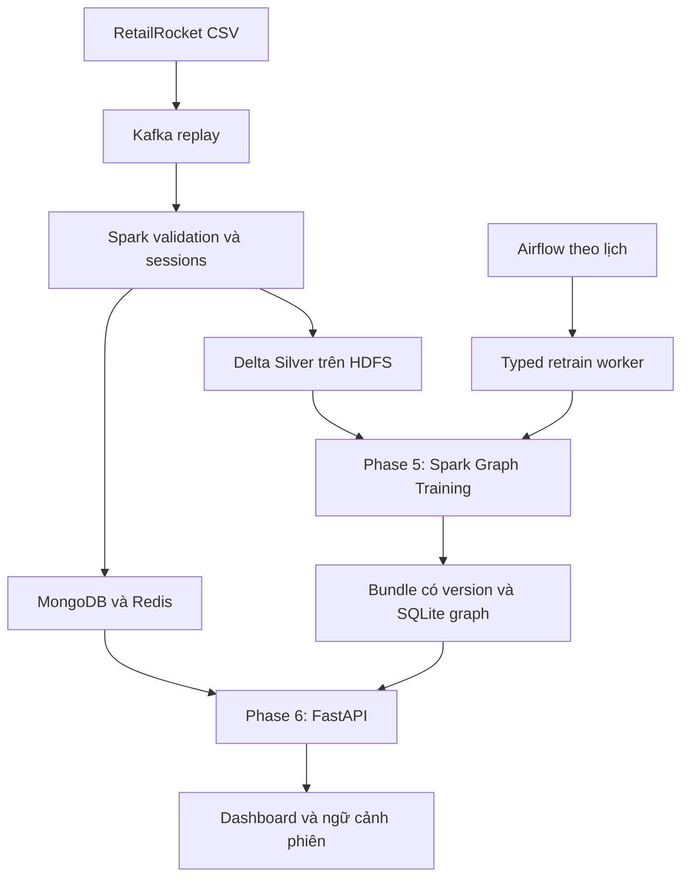

# Kiến trúc thống nhất Graph Phase 5 → Phase 6

Mô hình chính là conditional Item–Item kết hợp Session Transition, xây dựng bằng Spark SQL. Không còn nhánh ALS được runner chọn phục vụ. ALS nằm trong đối chứng tùy chọn, không có cơ chế chọn nó khi Graph kém hơn.

Hai chế độ chạy rõ ràng: pipeline tích hợp Kafka/Spark/HDFS/NoSQL/train; và snapshot serving API/Dashboard không cần hạ tầng Big Data đang chạy. CLI train Graph trực tiếp CSV hỗ trợ tái tạo riêng Phase 5 với Java/Spark, không chứng minh đã chạy Kafka/HDFS.

Graph build gồm co-occurrence theo visitor nhị phân với cap 20 item gần nhất và chuyển tiếp giữa timestamp group liên tiếp trong phiên gap 30 phút. Top100/seed/nhánh; context 5 seed gần nhất; fusion chuẩn hóa 75/25, power 0.5, affinity 0.8^r. Xem [Phase 5](PHASE_5.md) để biết công thức và giao thức.

Artifacts đặt dưới `outputs/runs/<run_id>/serving/`. Bundle/index cùng model_version; metric_model_version tách graph đánh giá và graph refit phục vụ. Bảng metadata SQLite và checksum SHA-256 ngăn ghép nhầm bundle/index. Run mới bất biến, công bố qua latest_run.json nguyên tử sau khi các bước bắt buộc thành công.

Readiness runtime từ chối artifact ALS lịch sử. Không tự rollback sang ALS khi graph mất hoặc kém chất lượng. API dùng Graph scorer chia sẻ với offline evaluation; Dashboard đọc metrics từ chính bundle, không hardcode số.

Giới hạn hạ tầng giữ nguyên: Compose demo một Kafka broker, replication 1; một NameNode/DataNode, HDFS replication 1; Spark local mode. Không có bằng chứng high availability hoặc tải nhiều máy. Chỉ một pipeline writer, phối hợp dừng live writer trước khi retrain. Các cổng host chỉ bind localhost. Đây là bản demo học thuật, không phải triển khai production.

Tính mới của gợi ý đến từ context request thay đổi; model chỉ đổi khi train/retrain có version mới. Các click UI mô phỏng chưa persist về Kafka. Dữ liệu gốc ẩn danh, tên/ảnh/giá/danh mục UI là minh họa, không đưa vào model. Không thể suy ra doanh thu/CTR thật vì thiếu dữ liệu nguồn cần thiết.

Tài liệu hiện hành: [Runbook](GRAPH_RUNBOOK.md), [đánh giá mô hình](ALS_VS_GRAPH.md), [kết quả](GRAPH_RESULTS.md), [kiểm thử](GRAPH_VALIDATION.md). Các tài liệu/metrics 2026-10-22 và bản ZIP storefront-v2 là lịch sử trước khi thống nhất; không dùng để khẳng định kết quả của lần sửa này.
