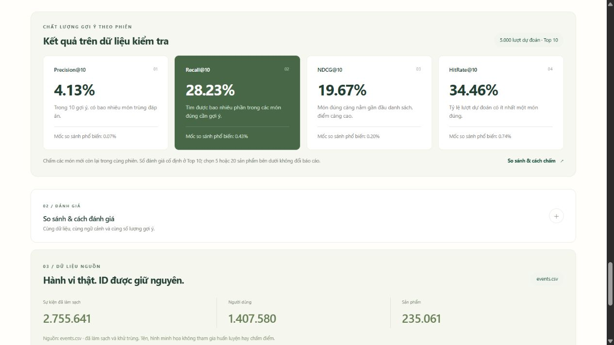

# Kiểm tra ZIP Graph trên Windows/Docker — 25/10/2026

## Kết luận

Snapshot `graph-full-20261024` chạy được trong thư mục giải nén mới, API dùng
`graph_session`, Dashboard đọc đúng phiên bản và chỉ số. ALS được giữ **chỉ
để đối chứng** theo lựa chọn của chủ dự án; không đổi họ mô hình phục vụ.

ZIP đầu vào: `RetailRocket_Graph_Unified_Full_Source.zip`, 80.730.247 byte,
SHA-256 `6f415299750e1e522b8b26f64b870b6cf3ae35223cdccdb68d84249a4df19d86`.
Đã kiểm CRC đủ 238 tệp và giải nén riêng vào
`D:\BIGDATA\RetailRocket_Graph_Unified\big-data-retailrocket`.
Thư mục sửa dở của bản trước được giữ riêng, không trộn vào bản này.

## Kiểm tra đã thực hiện

| Kiểm tra | Kết quả |
| --- | --- |
| Docker build từ source ZIP | Đạt; có dùng layer cache phụ thuộc đã có |
| Cài snapshot gzip vào outputs mới | Đạt; checksum và phiên bản sidecar khớp |
| Compose snapshot API | Healthy; kiểm tra ở cổng 8002, demo thường dùng cổng 8000 |
| Tính lại P/R/NDCG/HitRate từ test rankings | Khớp đủ 5.000 query, sai số < 1e-12 |
| Scorer offline so với HTTP | Khớp ID và điểm |
| Bộ hồi quy cách ly | 17 module exit 0; **146 trường hợp: 144 đạt, 2 skip** |
| Graph/API/scheduler contract sau sửa guard | **14/14 đạt**, gồm một kiểm thử mới; không cộng lặp với bộ trên |
| HTTP tải nhỏ | **100/100 thành công**, concurrency 4, 3 warmup |
| Trình duyệt thật | Xem → thêm giỏ → mua mô phỏng cập nhật context, lọc đủ ba ID đã tương tác; không có console error |
| Bảo toàn snapshot | Bundle, hai SQLite và pointer giữ nguyên hash trước/sau kiểm tra |

Hai trường hợp skip thuộc kiểm thử tích hợp opt-in của bộ gốc; không được tính
là đã chạy. Các kiểm thử Spark Graph và Spark ALS đối chứng đã bật khi chạy
bộ hồi quy. Log JVM có cảnh báo hostname/native Hadoop/socket của môi trường
container, nhưng tất cả module hoàn tất thành công.

Trong workload host Windows → Docker, mean khoảng **427 ms**, p95 khoảng
**634 ms**, p99 khoảng **682 ms**. Các kiểm thử Spark khác chạy đồng thời;
đây không phải SLA hoặc so sánh tốc độ công bằng với lần benchmark trước.

## Chỉ số xác nhận của snapshot

| Chỉ số Top 10 | Giá trị |
| --- | ---: |
| Precision | 4,1260% |
| Recall | 28,2271% |
| NDCG | 19,6734% |
| HitRate | 34,4600% |

Không huấn luyện lại full data trong lượt kiểm tra này. Các chỉ số là kết quả
đã lưu của graph đánh giá trước cutoff, được tính lại từ dự đoán và đối chiếu
với artifact/API. Không dùng graph phục vụ đã refit toàn lịch sử để chấm test.



## Thay đổi nhỏ sau khi rà soát

Sửa `normalize_events` để giữ dòng có `event=null` tới bước validation và báo
lỗi. Trước đó điều kiện SQL `event != 'review'` vô tình loại cả null, nên dòng
thiếu hành vi có thể bị bỏ qua âm thầm. Đã thêm kiểm thử Spark cho trường hợp
này. Sửa guard không làm thay đổi các artifact hoặc chỉ số của snapshot.

## Giới hạn và cách dùng

- Demo snapshot chỉ cần API; chưa chạy lại Kafka/HDFS/MongoDB/Redis của luồng
  tích hợp trong lượt kiểm tra này.
- Lịch 02:00 Việt Nam, submit/sensor và ràng buộc Graph của worker được kiểm
  tra bằng contract test. **Chưa chạy một DAG Airflow thật**.
- Snapshot không có thư mục `clean/` của ingestion. Muốn retrain qua Airflow,
  cần tạo run tích hợp có dữ liệu clean trước, như hướng dẫn GRAPH_RUNBOOK.
- Tên, hình, giá và danh mục trên cửa hàng là minh họa; ID và graph là từ bộ
  RetailRocket công khai. Thao tác mua không tạo đơn hàng hoặc học online.

Chạy từ thư mục dự án mới:

```powershell
powershell -NoProfile -ExecutionPolicy Bypass -File scripts/run_graph_demo.ps1
```

Bằng chứng mới tại [reports/verification/local_20261025](../reports/verification/local_20261025/).
Manifest nguồn `GRAPH_SOURCE_MANIFEST.json` giữ dấu vết ZIP đầu vào; manifest
`DELIVERY_SHA256.json` trong ZIP Release mới kiểm tra payload bàn giao hiện tại.
